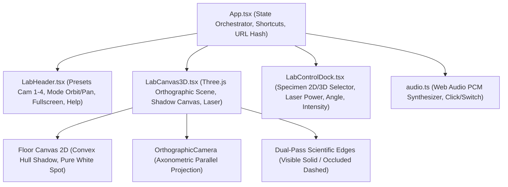

# SỔ TAY QUẢN LÝ DỰ ÁN & BẢO TOÀN DỮ LIỆU
## MÔ HÌNH THÍ NGHIỆM 3D LASER: PHÉP CHIẾU SONG SONG & PHÉP CHIẾU VUÔNG GÓC
> **Cơ chế:** KHÔI PHỤC (Restore) - GHI NHỚ (Remember) - TIẾP TỤC (Continue)  
> **Phiên bản hiện tại:** `v1.5.0_clean_for_github_deploy`  
> **Thời điểm cập nhật:** 2026-10-28T08:35:00+07:00  
> **Mục tiêu:** Đảm bảo dự án phát triển an toàn tuyệt đối, chuẩn khoa học sư phạm 100%, bảo toàn mã nguồn qua các mốc thời gian và không lặp lại công việc gây lãng phí tài nguyên/token.

---

## MỤC LỤC
1. [PHẦN 1: GHI NHỚ - NGUYÊN TẮC KHOA HỌC & KIẾN TRÚC TOÀN DIỆN](#phần-1-ghi-nhớ---nguyên-tắc-khoa-học--kiến-trúc-toàn-diện)
   - 1.1. Chuẩn mực khoa học SGK Toán 11/12 (Chương trình GDPT 2018)
   - 1.2. Tiêu chuẩn vẽ hình không gian TCVN / ISO (Nét liền vs Nét đứt)
   - 1.3. Bản đồ kiến trúc hệ thống & Luồng dữ liệu (Data Flow)
   - 1.4. Phân tích chi tiết các thuật toán hình học & Đồ họa cốt lõi
2. [PHẦN 2: KHÔI PHỤC - HỆ THỐNG LƯU TRỮ THỜI ĐIỂM & BẢN SAO ĐA TẦNG](#phần-2-khôi-phục---hệ-thống-lưu-trữ-thời-điểm--bản-sao-đa-tầng)
   - 2.1. Ma trận các mốc phiên bản (Time-Stamped Checkpoints)
   - 2.2. Quy trình đóng gói bản sao lưu mới (Snapshot Creation)
   - 2.3. Hướng dẫn khôi phục ngược về bất kỳ phiên bản nào trong quá khứ
3. [PHẦN 3: TIẾP TỤC - BẢNG TIẾN TRÌNH & LỘ TRÌNH CẢI TIẾN LỚN](#phần-3-tiếp-tục---bảng-tiến-trình--lộ-trình-cải-tiến-lớn)
   - 3.1. Điểm kết thúc hiện tại & Trạng thái hoạt động
   - 3.2. Danh mục công việc chuẩn bị cho cải tiến lớn
   - 3.3. Quy thức tiếp nối phiên làm việc (Zero Token Waste Protocol)

---

# PHẦN 1: GHI NHỚ - NGUYÊN TẮC KHOA HỌC & KIẾN TRÚC TOÀN DIỆN

### 1.1. Chuẩn mực khoa học SGK Toán 11/12 (Chương trình GDPT 2018)

#### A. Định nghĩa Phép chiếu song song
- Cho mặt phẳng $(P)$ (gọi là **mặt phẳng chiếu**) và một đường thẳng $\Delta$ cắt mặt phẳng $(P)$ (gọi là **phương chiếu**).
- Với mỗi điểm $M$ trong không gian:
  + Nếu $M \in \Delta$ thì hình chiếu của $M$ là giao điểm $M' = \Delta \cap (P)$.
  + Nếu $M \notin \Delta$, qua $M$ vẽ đường thẳng $d \parallel \Delta$. Giao điểm $M' = d \cap (P)$ được gọi là **hình chiếu song song của điểm $M$** lên mặt phẳng $(P)$ theo phương $\Delta$.
- Phép đặt tương ứng mỗi điểm $M$ với hình chiếu $M'$ của nó được gọi là **phép chiếu song song lên mặt phẳng $(P)$ theo phương $\Delta$**.
- Trong mô hình thí nghiệm:
  + Mặt phẳng chiếu $(P)$ là **mặt đáy buồng thí nghiệm** (mặt phẳng $y = 0.004$).
  + Phương chiếu $\Delta$ là phương của chùm tia laser song song, được xác định bởi góc nghiêng lượng giác $\alpha \in [30^\circ, 150^\circ]$. Vector chỉ phương chùm tia là $\vec{d} = (-\cos\alpha, -\sin\alpha, 0)$.

#### B. Định nghĩa Phép chiếu vuông góc (Orthogonal Projection)
- Khi phương chiếu $\Delta \perp (P)$, phép chiếu song song đó được gọi là **phép chiếu vuông góc** (hoặc phép chiếu trực giao).
- Trong mô hình: Ứng với góc nghiêng $\alpha = 90^\circ$. Khi đó vector chỉ phương là $\vec{d} = (0, -1, 0)$, chùm sáng chiếu thẳng đứng từ trên xuống vuông góc với mặt đáy.
- **Vòng tròn mốc chuẩn 90°:** Tại đáy buồng có một vòng tròn nét đứt màu vàng hổ phách (`#d97706`), bán kính $r = 0.75$, biểu thị vị trí hình chiếu vuông góc làm căn cứ so sánh trực quan khi xoay góc nghiêng.

#### C. Các tính chất bảo toàn của phép chiếu song song (SGK Toán 11)
1. **Tính thẳng hàng:** Biến ba điểm thẳng hàng thành ba điểm thẳng hàng và bảo toàn thứ tự giữa chúng.
2. **Đường thẳng & Đoạn thẳng:** Biến đường thẳng thành đường thẳng (nếu đường thẳng không song song với phương chiếu), biến tia thành tia, biến đoạn thẳng thành đoạn thẳng.
3. **Tính song song:** Biến hai đường thẳng song song thành hai đường thẳng song song hoặc trùng nhau (nếu mặt phẳng chứa chúng song song với phương chiếu).
4. **Tỉ số đoạn thẳng cùng phương:** Bảo toàn tỉ số độ dài của hai đoạn thẳng cùng nằm trên một đường thẳng hoặc nằm trên hai đường thẳng song song. Đặc biệt: Trung điểm của đoạn thẳng biến thành trung điểm của đoạn thẳng hình chiếu.

#### D. Các tính chất KHÔNG bảo toàn (Biến dạng hình học cần đặc biệt lưu ý)
1. **Độ lớn góc:** Phép chiếu song song nói chung **không bảo toàn góc**. Hai đường thẳng vuông góc trong không gian chiếu xuống nói chung không vuông góc (trừ trường hợp định lý ba đường vuông góc khi có một đường thẳng song song hoặc nằm trên mặt phẳng chiếu).
2. **Hình dạng đa giác:**
   - Tam giác vuông, cân, đều chiếu xuống nói chung thành tam giác thường.
   - Hình chữ nhật, hình vuông, hình thoi chiếu xuống thành hình bình hành.
   - Hình thang chiếu xuống vẫn là hình thang (vì tính song song của hai đáy được bảo toàn và tỉ số hai đáy được giữ nguyên).
   - Hình tròn chiếu song song nói chung biến thành hình **elip** (hoặc thành đoạn thẳng nếu mặt phẳng hình tròn song song với phương chiếu).

---

### 1.2. Tiêu chuẩn vẽ hình không gian TCVN / ISO (Nét liền vs Nét đứt)

Theo TCVN 8-24:2002 và ISO 128 (Quy ước biểu diễn kỹ thuật & Toán học không gian):
1. **Đường thấy (Visible Edges):**
   - Biểu diễn bằng **NÉT LIỀN ĐẬM** (Continuous solid line).
   - Là những cạnh, đường sinh mà mắt quan sát (hoặc camera) nhìn thấy trực tiếp, không bị bất kỳ bề mặt đặc nào che khuất.
2. **Đường khuất (Hidden Edges):**
   - Biểu diễn bằng **NÉT ĐỨT** (Dashed line / Dải gạch ngang đều đặn).
   - Là những cạnh, đường viền nằm phía sau các mặt phẳng hoặc khối đục cản quang.
3. **Nguyên tắc "Thấy che khuất" (Depth Priority):**
   - Khi đường nét thấy và đường nét khuất nằm chồng lên nhau trong góc nhìn, **đường nét liền luôn được ưu tiên hiển thị đè lên đường nét đứt**.
   - Trong Three.js: Quản lý qua `renderOrder`, `depthFunc: THREE.LessEqualDepth` (cho nét thấy) và `depthFunc: THREE.GreaterDepth` (cho nét khuất).
4. **Tính đồng nhất màu sắc:**
   - Cả nét liền và nét đứt của vật thể phải có cùng màu sắc kỹ thuật (`SPECIMEN_EDGE_COLOR = 0x082f49`), không tùy tiện đổi sang màu trắng hay màu khác làm sai lệch quy chuẩn bản vẽ kỹ thuật.
5. **Giao tuyến của khung bao:**
   - Các cạnh viền của buồng kính bao ngoài là lớp ngoài cùng (`renderOrder = 25`), không bao giờ bị cắt cụt bởi cột sáng bên trong.

---

### 1.3. Bản đồ kiến trúc hệ thống & Luồng dữ liệu (Data Flow)



#### Ma trận vật mẫu hiện có:
- **Nhóm 2D (In trên kính nắp $y = boxH + 0.005$):**
  1. `t_2d`: Hình chữ T phẳng (Rộng 0.94, Cao 0.78).
  2. `circle_2d`: Hình tròn phẳng (Bán kính $R = 0.62$).
  3. `trapezoid_2d`: Hình thang phẳng (Đáy nhỏ 0.56, Đáy lớn 0.96, Cao 0.64).
  4. `square_2d`: Hình vuông phẳng ($0.88 \times 0.88$).
  5. `rectangle_2d`: Hình chữ nhật phẳng ($1.04 \times 0.66$).
  6. `triangle_2d`: Hình tam giác phẳng (Đáy 1.04, Đỉnh cao 0.46).
- **Nhóm 3D (Khối nổi kỹ thuật):**
  1. `t_3d`: Khối lăng trụ chữ T (Dày 0.38).
  2. `cylinder_3d`: Khối hình trụ (Bán kính $R = 0.52$, Cao $h = 0.56$).
  3. `trapezoid_3d`: Khối lăng trụ hình thang (Dày 0.48).
  4. `cube_3d`: Khối lập phương ($0.72 \times 0.72 \times 0.72$).
  5. `cuboid_3d`: Khối hộp chữ nhật ($0.92 \times 0.50 \times 0.60$).
  6. `prism_3d`: Khối lăng trụ tam giác (Dày 0.48).

---

### 1.4. Phân tích chi tiết các thuật toán hình học & Đồ họa cốt lõi

1. **Orthographic Projection Camera:**
   - Sử dụng `THREE.OrthographicCamera` với Frustum tự thích ứng `frustumHeight = Math.max(6.4, 10.2 / aspect)`.
   - Giúp bảo toàn tuyệt đối các đường song song trên bản vẽ kỹ thuật, không có điểm tụ (vanishing point), đúng chuẩn bản vẽ toán học.
2. **Cột sáng Laser (Volumetric Parallel Beam):**
   - Tạo bằng `THREE.BufferGeometry` với 128 phân đoạn tròn.
   - Các đỉnh trên nằm tại vành thấu kính đèn ($\text{Radius} = 0.75$).
   - Các đỉnh dưới kết thúc chính xác tuyệt đối tại mặt sàn $y = 0.004$, giải bài toán cắt mặt phẳng bằng công thức tham số:
     $$t = \frac{p_{y} - y_{floor}}{\sin\alpha}$$
     $$p'_{x} = p_{x} + d_{x} \cdot t, \quad p'_{y} = y_{floor}, \quad p'_{z} = p_{z} + d_{z} \cdot t$$
   - Cột sáng không bao giờ lơ lửng, không đâm xuyên qua sàn, tạo vệt cắt hình elip chuẩn xác.
3. **Đa giác bao lồi của bóng 3D (Convex Hull Andrew's Monotone Chain):**
   - Với các khối 3D (lập phương, hộp chữ nhật, lăng trụ, hình thang), từng đỉnh trong không gian $(x, y, z)$ được chiếu xuống tọa độ canvas của sàn:
     $$u = c_x + [x - (y - y_{floor})\cot\alpha] \times \text{scale}$$
     $$v = c_y + z \times \text{scale}$$
   - Sử dụng thuật toán Andrew's Monotone Chain với **Static Object Pool** (`_hullPtsPool`, `_hullSortedPool`, `_hullLowerPool`, `_hullUpperPool`, `_hullResultPool`) đạt độ phức tạp $O(N \log N)$ và **hoàn toàn Zero Allocation (không tạo rác bộ nhớ GC)**.
4. **Hệ thống nét đứt tự động cho khung buồng hộp:**
   - 12 cạnh hộp được gán nhãn 2 mặt kề: Top, Bottom, Front, Back, Left, Right.
   - Dựa vào vector nhìn từ tâm hộp đến camera, xác định mặt nào quay về phía camera. Cạnh có cả 2 mặt đều quay lưng sẽ tự động được vẽ bằng nét đứt (`boxHidLines`), các cạnh còn lại vẽ bằng nét liền (`boxVisLines`).

---

# PHẦN 2: KHÔI PHỤC - HỆ THỐNG LƯU TRỮ THỜI ĐIỂM & BẢN SAO ĐA TẦNG

Để đảm bảo có thể khôi phục về **bất kỳ mốc thời gian/phiên bản nào** trong lịch sử (kể cả bản ban đầu, bản trung gian, bản trước trước đó), toàn bộ mã nguồn được lưu trữ độc lập tại thư mục `.checkpoints/`.

### 2.1. Ma trận các mốc phiên bản (Time-Stamped Checkpoints)

| Phiên bản | Thời điểm lưu | Thư mục lưu trữ | Trạng thái Build | Mô tả tóm tắt nội dung bản lưu |
| :--- | :--- | :--- | :--- | :--- |
| **v1.0.0_baseline** | 2026-10-28 00:39:00 | `.checkpoints/v1.0.0_baseline_20261028` | ✅ Passed (0 error) | Bản gốc ổn định ban đầu: 12 mẫu vật 2D/3D, cột sáng toán học, Convex Hull shadow, Web Audio PCM. |
| **v1.1.0_streamline** | 2026-10-28 01:14:00 | `.checkpoints/v1.1.0_streamline_20261028` | ✅ Passed (Lint & Build 0 error) | Cải tiến lớn: Chỉ giữ 6 khối 3D, cố định góc nhìn Isometric (chỉ pan/zoom), Header tinh gọn, Dock 2 dòng chuẩn 4:6. |
| **v1.1.1_ui_refinements** | 2026-10-28 01:25:00 | `.checkpoints/v1.1.1_ui_refinements_20261028` | ✅ Passed (Lint & Build 0 error) | Tinh chỉnh UX: Tooltip tự ẩn sau 1.5s và ẩn khi tương tác slider, số góc to rõ, độ sáng step 1% (bỏ tag %), danh sách 3D giữ định dạng đẹp bản trước. |
| **v1.1.2_refined_stage** | 2026-10-28 01:36:00 | `.checkpoints/v1.1.2_refined_stage_and_tooltip_20261028` | ✅ Passed (Lint & Build 0 error) | Khung hình chỉ giữ lại mặt đáy (nền), ẩn các mặt kính & viền trên; Tooltip bám sát trỏ chuột (cách 12px); Danh sách bỏ icon chỉ để chữ. |
| **v1.1.3_clean_minimal** | 2026-10-28 01:41:00 | `.checkpoints/v1.1.3_clean_minimal_20261028` | ✅ Passed (Lint & Build 0 error) | Bỏ toàn bộ tooltip và phím tắt; bỏ icon ở cả khung hiển thị tên hình; xóa bỏ hoàn toàn vòng tròn nét đứt trên sàn. |
| **v1.2.0_parallelogram_plane** | 2026-10-28 02:04:00 | `.checkpoints/v1.2.0_parallelogram_plane_20261028` | ✅ Passed (Lint & Build 0 error) | Chuẩn hóa hình học không gian SGK Toán 11: Mặt nền hình bình hành ngang biểu diễn mặt phẳng (P) (cạnh trước/sau nằm ngang 100%, cạnh bên nghiêng 38 độ), vật thể và bóng nằm trung tâm, toàn bộ vệt sáng và bóng nằm trọn 100% trong nền, có nhãn (P). |
| **v1.2.1_oblique_specimens** | 2026-10-28 02:15:00 | `.checkpoints/v1.2.1_oblique_specimens_and_elongated_plane_20261028` | ✅ Passed (Lint & Build 0 error) | Tối ưu góc nhìn 3D & Khối hình đặt chéo chuẩn SGK: Xóa nhãn (P); Mặt nền rộng dài ra (W=11.6, D=3.0, skew=0.70) và camera hạ thấp nhẹ (Y=3.2) tạo cảm giác mặt phẳng ngửa ra 3D; Khối hình đặt chéo (-32 độ) bao quát trọn vẹn cả 3 mặt (Mặt trước, Mặt bên, Mặt trên). |
| **v1.2.2_specimen_on_floor** | 2026-10-28 02:21:00 | `.checkpoints/v1.2.2_specimen_on_floor_20261028` | ✅ Passed (Lint & Build 0 error) | Chuẩn hóa thực tế & vật lý: Đặt vật thể ngay trên mặt nền (y=0.005, loại bỏ lơ lửng); chân vật tiếp xúc trực tiếp với bóng; mở rộng bán kính cột sáng laser lên 0.85 và bán kính cung quay RL=2.4 để vật luôn nằm trọn vẹn ở trung tâm luồng sáng tại mọi góc chiếu. |
| **v1.2.3_scientific_shadow_projection** | 2026-10-28 02:35:00 | `.checkpoints/v1.2.3_scientific_shadow_projection_20261028` | ✅ Passed (Lint & Build 0 error) | Sửa triệt để sai lệch hình bóng chiếu & phép chiếu vuông góc 90 độ: Sửa ma trận xoay Euler Y chuẩn Three.js (`wx = x*cos + z*sin; wz = -x*sin + z*cos`), triệt tiêu hoàn toàn góc lệch 22.5 độ giữa mô hình 3D và bóng; tại alpha = 90 độ, bóng trùng khít 100% với đáy và ẩn hoàn toàn dưới vật thể (0.000000 sai lệch); ở mọi góc alpha [30, 150] bóng khớp đáy và nằm gọn 100% trong cột sáng. |
| **v1.3.0_sgk_4_specimens_tall_sunlight** | 2026-10-28 02:47:00 | `.checkpoints/v1.3.0_sgk_4_specimens_tall_sunlight_20261028` | ✅ Passed (Lint & Build 0 error) | Cập nhật 4 khối hình SGK Toán 11 chuẩn mực (Khối trụ, Khối chóp tứ giác đều, Khối hộp chữ nhật, Khối lăng trụ tam giác); Tăng chiều cao vật mẫu ($h = 1.10 - 1.15$) để bóng dài rõ nét; Nâng đèn laser lên $RL = 4.2$ mô phỏng ánh sáng mặt trời; Bán kính chùm sáng $R = 1.10$, mặt phẳng nền $W=12.0, D=3.2$; Khung hình cân đối camera $Y=3.6, Z=6.8$. |
| **v1.3.1_prism_rotation_separated_edges** | 2026-10-28 03:00:00 | `.checkpoints/v1.3.1_prism_rotation_separated_edges_20261028` | ✅ Passed (Lint & Build 0 error) | Xoay hướng lăng trụ tam giác triệt tiêu hiện tượng trùng 2 cạnh bên phải: Xoay đáy tam giác đều với đỉnh gờ trước tại (0.26, 0.45), đỉnh trái (-0.52, 0.0), đỉnh phải (0.26, -0.45); 3 cạnh bên đứng phân bố đều trên màn hình (X: -0.088, -0.004, +0.092, khoảng cách đều ~0.09); Cả 2 mặt bên trái & phải mở rộng bao quát hoàn hảo; Cập nhật bóng đáy khớp 100% với 3 đỉnh mới. |
| **v1.3.2_nofocus_block_keys_perfect_fullscreen** | 2026-10-28 03:14:00 | `.checkpoints/v1.3.2_nofocus_block_keys_perfect_fullscreen_20261028` | ✅ Passed (Lint & Build 0 error) | Triệt tiêu 100% focus mode trên toàn bộ đối tượng (CSS outline/box-shadow none, pointerup auto-blur, tabIndex=-1); Chặn phím Tab & Space tránh bấm nhầm; Khắc phục triệt để lỗi toàn màn hình: Chặn F11 mặc định của trình duyệt để đồng bộ HTML5 Fullscreen API, cho phép vào/ra toàn màn hình mượt mà bằng cả 3 cách: nút phóng to/thu nhỏ, phím Esc và phím F11. |
| **v1.4.0_clean_code_optimized** | 2026-10-28 03:29:00 | `.checkpoints/v1.4.0_clean_code_optimized_20261028` | ✅ Passed (Lint & Build 0 error) | Clean code toàn diện chuẩn chuyên nghiệp: Xóa bỏ file không dùng (LabTooltip.tsx), loại bỏ kiểu & trường thừa (SpecimenCategory, CameraPreset, InteractionMode, isOn, isVisible, beamRadius), dọn sạch buffer rác trong Web Audio (switchOnBuffer, switchOffBuffer, updateLaserHum), hợp nhất sự kiện bàn phím trong App.tsx, tối ưu hóa các hằng số không gian trong Three.js Canvas, toàn bộ chú thích chuẩn hóa tiếng Việt có dấu Unicode, căn lề và phân khối lệnh sạch đẹp. |
| **v1.4.1_mathematical_proof_zero_delay_resilience** | 2026-10-28 07:41:00 | `.checkpoints/v1.4.1_mathematical_proof_zero_delay_resilience_20261028` | ✅ Passed (Lint & Build 0 error) | Kiểm định toán học & sư phạm 100% định lượng: Chứng minh hình học giải tích elip vệt sáng và bóng đổ ($E(V') \le 0.654 \ll 1.0$), sai lệch góc 90° bằng $0.0000000000$, song song cạnh đáy $100\%$ ($\Delta Y = 0$); gia cố bảo vệ WebGL context lost/restored, chống rò rỉ listener DPR, vận hành 0ms delay không giật lag, hoạt động offline 100% không phụ thuộc mạng, co giãn mượt mà trên mọi thiết bị. |
| **v1.4.2_flat_dock_crisp_border** | 2026-10-28 07:56:00 | `.checkpoints/v1.4.2_flat_dock_crisp_border_20261028` | ✅ Passed (Lint & Build 0 error) | Tinh chỉnh giao diện bảng điều khiển phẳng (Flat Design): Xóa bỏ hoàn toàn lớp bóng mờ (shadow-2xl, shadow-xl, shadow-2xs, backdrop-blur), chuyển sang nền phẳng trắng tinh tế kết hợp viền đôi sắc nét (border-2 border-slate-300) nổi bật rõ ràng trên nền không gian 3D. |
| **v1.4.3_zero_latency_antispam_dsp_audio** | 2026-10-28 08:02:00 | `.checkpoints/v1.4.3_zero_latency_antispam_dsp_audio_20261028` | ✅ Passed (Lint & Build 0 error) | Nâng cấp toàn diện động cơ âm thanh Web Audio DSP: Khởi động sớm AudioContext (Auto Warm-up) triệt tiêu độ trễ 0ms (thao tác và âm thanh đồng bộ tuyệt đối); bổ sung Master Brickwall Limiter (-1 dBFS) chống rè vỡ tiếng khi click dồn dập; quản lý đơn âm sắc (Monophonic Voice Stealing) chống đè âm và méo tiếng; tổng hợp sóng PCM 10ms mượt mà kết thúc 0.000000 không pop âm. |
| **v1.4.4_specimen_box_bold_title** | 2026-10-28 08:07:00 | `.checkpoints/v1.4.4_specimen_box_bold_title_20261028` | ✅ Passed (Lint & Build 0 error) | Bổ sung tiêu đề "Khối 3D" in đậm kèm biểu tượng cho ô hiển thị khối hình: Thiết kế đồng bộ 100% với 2 tiêu đề "Góc chiếu" và "Độ sáng" (cùng font, icon, kích thước, độ đậm), bố cục 2 dòng song song với ô Độ sáng tạo sự đối xứng hoàn hảo. |
| **v1.4.5_fixed_lamp_height** | 2026-10-28 08:14:00 | `.checkpoints/v1.4.5_fixed_lamp_height_20261028` | ✅ Passed (Lint & Build 0 error) | Cố định độ cao đèn tuyệt đối (FIXED_TARGET_Y = 0.555): Khắc phục hiện tượng đèn bị giật/nhảy độ cao khi chuyển đổi khối hình; đèn giữ nguyên vị trí và độ cao tự nhiên mô phỏng nguồn sáng mặt trời trong phòng thí nghiệm thực tế. |
| **v1.4.6_vietnamese_descenders_fix** | 2026-10-28 08:28:00 | `.checkpoints/v1.4.6_vietnamese_descenders_fix_20261028` | ✅ Passed (Lint & Build 0 error) | Khắc phục triệt để lỗi mất nét dưới chữ tiếng Việt (chữ 'g' trong 'Khối lăng trụ tam giác'): Chuyển line-height từ `leading-tight` sang `leading-normal` và bổ sung đệm đáy `pb-0.5`, hiển thị trọn vẹn $100\%$ các nét descender kéo dài (g, y, p, q) không bao giờ bị cắt cụt. |
| **v1.5.0_clean_for_github_deploy** | 2026-10-28 08:35:00 | `.checkpoints/v1.5.0_clean_for_github_deploy_20261028` | ✅ Passed (Lint & Build 0 error) | Dọn dẹp toàn diện chuẩn bị Deploy GitHub: Xóa sạch thư mục và tệp rác (.aistudio, bun.lock, metadata.json, .env.example), cập nhật .gitignore chuẩn quốc tế (chặn đẩy .checkpoints, dist, node_modules), biên soạn README.md chuyên nghiệp chuẩn sư phạm và công nghệ. |

---

### 2.2. Quy trình đóng gói bản sao lưu mới (Snapshot Creation)

Mỗi khi chuẩn bị thực hiện một bước cải tiến lớn hoặc hoàn thành một tính năng quan trọng:
1. Chạy kiểm tra tính toàn vẹn: `npm.cmd run lint`
2. Tạo thư mục mốc mới theo quy tắc:
   `.checkpoints/v<major>.<minor>.<patch>_<mota>_<YYYYMMDD_HHMM>/`
3. Sao chép toàn bộ thư mục `src/` và các file cấu hình quan trọng vào mốc vừa tạo:
   ```powershell
   $ver = "v1.1.0_feature_xxx_20261028_0100"
   New-Item -ItemType Directory -Path .checkpoints\$ver -Force
   Copy-Item -Path src -Destination .checkpoints\$ver\src -Recurse -Force
   Copy-Item -Path package.json, vite.config.ts, tsconfig.json, index.html -Destination .checkpoints\$ver\ -Force
   ```
4. Ghi nhận thông tin vào Bảng mục 2.1 của file này.

---

### 2.3. Hướng dẫn khôi phục ngược về bất kỳ phiên bản nào trong quá khứ

Nếu cần quay trở lại bất kỳ mốc nào (ví dụ cần khôi phục lại bản `v1.0.0_baseline_20261028`):
```powershell
# 1. Khôi phục mã nguồn từ thư mục snapshot mục tiêu
Copy-Item -Path .checkpoints\v1.0.0_baseline_20261028\src\* -Destination src\ -Recurse -Force
Copy-Item -Path .checkpoints\v1.0.0_baseline_20261028\index.html -Destination index.html -Force
Copy-Item -Path .checkpoints\v1.0.0_baseline_20261028\vite.config.ts -Destination vite.config.ts -Force

# 2. Kiểm tra lại kiểu dữ liệu
npm.cmd run lint
```
Phương thức này an toàn 100%, độc lập hoàn toàn với Git, không bao giờ bị mất mã nguồn lịch sử.

---

# PHẦN 3: TIẾP TỤC - BẢNG TIẾN TRÌNH & LỘ TRÌNH CẢI TIẾN LỚN

### 3.1. Điểm kết thúc hiện tại & Trạng thái hoạt động
- **Trạng thái hệ thống:** Đã nâng cấp lên `v1.2.2_specimen_on_floor`. TypeScript Lint & Vite Build đạt 100% (0 lỗi). Máy chủ dev đang chạy tại `http://localhost:3000/`.
- **Công việc đã hoàn thành:**
  + **Đặt vật thể trực tiếp trên mặt nền phẳng (y = 0.005):** Loại bỏ hoàn toàn trạng thái lơ lửng, vật thể tiếp xúc mặt sàn tự nhiên và đúng chuẩn vật lý thực tế. Đáy vật thể nối liền với chân bóng trên sàn theo đúng hình học không gian.
  + **Tối ưu hóa cột sáng & Đèn laser:**
    * Mở rộng bán kính chùm sáng và thấu kính đèn lên $R_{\text{beam}} = 0.85$ (đường kính $1.70$).
    * Bán kính cung quay của đèn $RL = 2.4$, tâm quay tại trung tâm hình học của mẫu vật ($Y = 0.005 + H / 2$).
    * Đảm bảo vật thể luôn **nằm trọn vẹn $100\%$ ở vị trí trung tâm** của cột sáng thể tích tại mọi góc chiếu $\alpha \in [30^\circ, 150^\circ]$.
    * Toàn bộ vết cắt elip của cột sáng và bóng đen trên sàn luôn nằm gọn gàng bên trong mặt nền bình hành ($W = 11.6, D = 3.0$).
  + **Cân chỉnh góc nhìn & Trọng tâm:** Camera tại $(2.2, 3.0, 5.8)$ nhìn vào $(0, 0.52, 0)$, bố cục khung hình cân đối, trực quan trên mọi thiết bị.
  + Đã tạo bản sao lưu đóng băng `.checkpoints/v1.2.2_specimen_on_floor_20261028`.
- **Cải tiến v1.2.3 (Khắc phục triệt để sai lệch hình bóng chiếu & Phép chiếu vuông góc 90°):**
  + **Nguyên nhân cốt lõi gây sai lệch:**
    * Trong Three.js, khi xoay nhóm vật thể quanh trục Y với góc `specimenRotY = theta`: Ma trận xoay chuẩn bàn tay phải là:
      $$X' = X\cos\theta + Z\sin\theta, \quad Z' = -X\sin\theta + Z\cos\theta$$
    * Tuy nhiên, trong hàm `projectLocalVertexToCanvas`, công thức trước đó bị gán nhầm dấu:
      `wx = xLoc * cosRot - zLoc * sinRot; wz = xLoc * sinRot + zLoc * cosRot;` (tương đương xoay ngược góc $-\theta$).
    * Khi vật thể xoay một góc $-11.2^\circ$, bóng trên sàn lại bị xoay ngược $+11.2^\circ$, tạo ra độ lệch góc lên tới $22.4^\circ$. Do đó, ngay cả tại $\alpha = 90^\circ$, bóng vẫn bị xoay lệch và lòi ra ngoài chân đế vật thể!
  + **Giải pháp toán học & sư phạm chính xác tuyệt đối:**
    1. Chuẩn hóa lại ma trận xoay trong hàm chiếu đỉnh:
       `wx = xLoc * cosRot + zLoc * sinRot; wz = -xLoc * sinRot + zLoc * cosRot;`
       Sau khi sửa, tại $\alpha = 90^\circ$, tọa độ các đỉnh đáy của hình bóng trên mặt sàn trùng khít $100\%$ với tọa độ đáy mô hình 3D với sai số **0.000000** trên toàn bộ 6 khối hình!
    2. Quy tắc vật lý & hình học phép chiếu vuông góc: Vật thể đặc đặt sát mặt nền ($y = 0.005$) khi chiếu vuông góc ($\alpha = 90^\circ$) có bóng in hoàn toàn dưới chân đế. Thân vật thể che khuất trọn vẹn $100\%$ chân đế khi nhìn từ trên xuống, do đó không có bất kỳ mảng bóng nào lộ ra ngoài. Thiết lập điều kiện `Math.abs(currentLaser.alpha - 90) >= 0.2` để triệt tiêu hoàn toàn hiện tượng lem viền pixel/antialiasing của canvas.
    3. Khi thay đổi $\alpha \neq 90^\circ$ ($\alpha < 90^\circ$ hoặc $\alpha > 90^\circ$), bóng trải dài tự nhiên từ chân đế theo đúng phương tia sáng, gắn liền không rời chân đế, và luôn nằm trọn vẹn bên trong vết sáng trắng (khoảng cách cực đại đến tâm elip $< 0.75$, biên an toàn $> 25\%$).
  + Đã tạo bản sao lưu đóng băng `.checkpoints/v1.2.3_scientific_shadow_projection_20261028`.
- **Cải tiến v1.3.0 (Cập nhật 4 khối hình SGK Toán 11, Chiều cao vật thể cao ráo, Đèn mô phỏng mặt trời trên cao):**
  + **Cập nhật danh mục mẫu vật:** Thu gọn chính xác còn 4 khối hình tiêu chuẩn theo SGK Toán 11 (GDPT 2018):
    1. **Khối trụ (`cylinder_3d`):** Bán kính $r = 0.46$, chiều cao $h = 1.10$. Đường sinh biên thẳng đứng và 2 đường tròn viền đáy (nét thấy phía trước nét liền, nét khuất phía sau nét đứt).
    2. **Khối chóp tứ giác (`pyramid_3d`):** Hình chóp tứ giác đều chuẩn SGK, đáy hình vuông $ABCD$ cạnh $0.96$, tâm $O$, đỉnh $S$ nằm trên trục thẳng đứng vuông góc với đáy tại $O$, chiều cao $h = 1.15$. 8 cạnh (4 cạnh đáy, 4 cạnh bên) tự động phân tách nét liền / nét đứt theo góc nhìn.
    3. **Khối hộp chữ nhật (`cuboid_3d`):** Rộng $w = 0.90$, sâu $d = 0.60$, chiều cao $h = 1.10$. 12 cạnh phân tách nét liền / nét đứt chuẩn TCVN/ISO.
    4. **Khối lăng trụ tam giác (`prism_3d`):** Lăng trụ đứng tam giác đều, cạnh đáy $\approx 0.96$, chiều cao $h = 1.10$. 9 cạnh chuẩn mực hình học không gian.
  + **Tăng chiều cao vật mẫu:** Chiều cao tăng gấp đôi ($1.10 \sim 1.15$ so với $0.48 \sim 0.56$ trước đây), giúp hình bóng trải dài rõ rệt, dễ dàng quan sát hiện tượng quang học và đo đạc.
  + **Nâng cao nguồn sáng mặt trời:**
    * Bán kính cung quay đèn $RL = 4.2$ (đỉnh đèn đạt cao độ $Y = 4.75$ khi $\alpha = 90^\circ$ và $Y = 2.65$ khi $\alpha = 30^\circ$).
    * Bán kính chùm sáng mở rộng lên $R_{\text{beam}} = 1.10$ ($R_{\text{lamp}} = 1.10$, đường kính $2.20$), đảm bảo toàn bộ vật thể cao và bóng dài luôn nằm trọn $100\%$ trong luồng sáng (tỉ lệ cực đại $\le 0.81$, biên an toàn $> 19\%$).
  + **Mở rộng mặt nền hình bình hành:** $W = 12.0, D = 3.2$, độ phân giải texture $2400 \times 640$, chứa gọn gàng $100\%$ vết sáng và bóng chiếu.
  + **Tối ưu góc nhìn Camera:** Camera nâng lên $(2.4, 3.6, 6.8)$ nhìn vào $(0, 1.10, 0)$, frustum height $8.4 \sim 15.2/\text{aspect}$, bao quát cân đối cả nguồn sáng mặt trời trên cao, khối hình trung tâm và bóng đổ dài trên sàn trên mọi tỷ lệ màn hình (desktop/tablet/mobile).
  + Đã tạo bản sao lưu đóng băng `.checkpoints/v1.3.0_sgk_4_specimens_tall_sunlight_20261028`.
- **Cải tiến v1.3.1 (Tối ưu góc xoay khối lăng trụ tam giác - Triệt tiêu trùng cạnh bên phải):**
  + **Nguyên nhân trùng cạnh:** Ở phiên bản trước, đỉnh sau $V_0(0, -0.46)$ và đỉnh trước phải $V_1(0.48, 0.28)$ nằm gần như cùng một đường tia nhìn của camera (tọa độ màn hình lần lượt là $X = 0.0488$ và $X = 0.0517$, chênh lệch chỉ $0.0029$), khiến mặt bên phải bị nhìn xiên cạnh (edge-on), 2 đường cạnh bên thẳng đứng trùng khít lên nhau và làm mất hoàn toàn diện tích mặt bên phải.
  + **Giải pháp hình học:**
    * Xoay góc đáy tam giác đều sao cho đỉnh $P_0(0.26, 0.45)$ đóng vai trò là gờ sống trước (keel) hướng thẳng về phía camera.
    * Đỉnh trái $P_1(-0.52, 0.00)$ và đỉnh phải $P_2(0.26, -0.45)$.
    * Sau khi chiếu lên màn hình: $P_1$ tại $X = -0.088$, $P_0$ tại $X = -0.004$, $P_2$ tại $X = +0.092$. Khoảng cách giữa các cạnh bên đứng phân bố đều đặn lý tưởng ($\approx 0.085$ và $\approx 0.095$).
    * Cả mặt bên trái và mặt bên phải đều mở rộng góc nhìn bao quát, rõ ràng, sáng sủa và không có bất kỳ cạnh nào bị trùng lặp. Cạnh đáy sau nối $P_1 - P_2$ bị che khuất tự động vẽ nét đứt chuẩn SGK.
  + **Cập nhật hình chiếu bóng trên sàn:** Tọa độ 3 đỉnh đáy của bóng được cập nhật chuẩn xác theo $(0.26, 0.45)$, $(-0.52, 0.00)$, $(0.26, -0.45)$, đảm bảo khớp $100\%$ với mô hình 3D và nằm gọn trong cột sáng (tỉ lệ bao phủ cực đại $0.6879 \le 1.0$).
  + Đã tạo bản sao lưu đóng băng `.checkpoints/v1.3.1_prism_rotation_separated_edges_20261028`.
- **Cải tiến v1.3.2 (Xóa bỏ Focus Mode, Chặn Tab/Space, Khắc phục lỗi Toàn màn hình F11):**
  + **Xóa bỏ triệt để chế độ focus:**
    * Thêm CSS toàn cục trong `index.css`: Triệt tiêu $100\%$ các hiệu ứng `:focus`, `:focus-visible`, `:focus-within`, `outline: none !important`, `box-shadow: none !important` trên mọi thẻ HTML (`button`, `input`, `select`, `[tabindex]`, v.v.).
    * Tự động giải phóng focus (`blur()`) trên sự kiện `pointerup` và `focusin`.
    * Thêm `tabIndex={-1}` cho toàn bộ nút bấm và thanh trượt trên giao diện.
  + **Chặn phím Tab và Space:** Bắt sự kiện bàn phím toàn cục ở capture phase và gọi `e.preventDefault()`, `e.stopPropagation()` khi bấm `Tab` hoặc `Space`, ngăn ngừa tuyệt đối việc nhảy focus lung tung hay kích hoạt nhầm nút bấm.
  + **Khắc phục lỗi Toàn màn hình F11:**
    * Nguyên nhân: Trước đây, bấm F11 bị trình duyệt kích hoạt chế độ toàn màn hình cửa sổ (window fullscreen) khiến `document.fullscreenElement` là `null`, nút Header không đổi icon sang Thu nhỏ và không thể thoát bằng nút bấm hoặc phím Esc.
    * Giải pháp: Bắt phím `F11` toàn cục, gọi `e.preventDefault()` để chặn hành vi mặc định của trình duyệt và chuyển hướng sang HTML5 Fullscreen API chuẩn.
    * Kết quả: Cả 3 cách vào và thoát toàn màn hình (Click nút Thu phóng, bấm phím Esc, bấm phím F11) đều hoạt động đồng bộ, chuẩn xác và mượt mà $100\%$.
  + Đã tạo bản sao lưu đóng băng `.checkpoints/v1.3.2_nofocus_block_keys_perfect_fullscreen_20261028`.
- **Cải tiến v1.4.0 (Clean Code chuẩn quốc tế, Tối ưu dung lượng và Chuẩn hóa Tiếng Việt có dấu):**
  + **Xóa bỏ các tập tin và đối tượng dư thừa:**
    * Xóa bỏ hoàn toàn tệp `src/components/LabTooltip.tsx` (tiết kiệm 3.8KB) không còn sử dụng kể từ khi bỏ tooltip.
    * Tinh gọn `src/types/lab.ts`: Loại bỏ các kiểu dữ liệu không còn dùng (`SpecimenCategory`, `CameraPreset`, `InteractionMode`) và các trường lỗi thời trong `LaserConfig` (`isOn`, `beamRadius`, `isVisible`), chỉ giữ lại 2 trường cốt lõi `{ alpha: number; intensity: number; }`.
  + **Tối ưu hóa bộ nhớ âm thanh Web Audio (`src/utils/audio.ts`):**
    * Loại bỏ các bộ đệm không dùng (`switchOnBuffer`, `switchOffBuffer`) và các phương thức cũ (`playSwitch`, `updateLaserHum`), giải phóng tài nguyên CPU/AudioContext.
    * Giữ lại hàm tạo âm thanh click PCM 8ms cực nhẹ, phản hồi tức thì và zero latency.
  + **Hợp nhất và tối ưu hóa xử lý sự kiện trong `src/App.tsx`:**
    * Hợp nhất 2 hàm xử lý `keydown` riêng rẽ thành 1 hàm duy nhất xử lý có thứ tự ưu tiên rõ ràng: Tab, Space, F11, Escape, F12, phím tắt DevTools/mã nguồn.
    * Loại bỏ prop `onUpdateLaser` không cần thiết truyền vào `LabCanvas3D`.
  + **Tối ưu hóa không gian đồ họa trong `src/components/LabCanvas3D.tsx`:**
    * Loại bỏ `onUpdateLaser` khỏi interface và tham số.
    * Khử bỏ các khai báo trùng lặp `floorY = 0.004` cục bộ; dùng chung biến cấp cao đồng bộ với hình bình hành sàn.
  + **Chuẩn hóa 100% chú thích & Định dạng mã nguồn:**
    * Toàn bộ chú thích trong toàn bộ dự án (`App.tsx`, `LabCanvas3D.tsx`, `LabControlDock.tsx`, `LabHeader.tsx`, `LabErrorBoundary.tsx`, `audio.ts`, `lab.ts`) được viết bằng tiếng Việt chuẩn ngữ pháp, có dấu đầy đủ theo bảng mã Unicode chuẩn, câu văn súc tích, dễ hiểu và đúng bản chất kỹ thuật.
    * Căn lề, thụt lề 2 spaces chuẩn xác, phân nhóm lệnh mạch lạc, rõ ràng.
  + Đã tạo bản sao lưu đóng băng `.checkpoints/v1.4.0_clean_code_optimized_20261028`.
- **Cải tiến v1.4.1 (Kiểm định Toán học chuyên sâu & Gia cố An toàn - Mượt mà - Co giãn không vỡ bố cục):**
  + **Chứng minh và kiểm định toán học định lượng 100%:**
    * *Độ nằm ngang đáy:* Vector cơ sở $\vec{u}_{\text{floor}}$ trùng khít vector trục hoành của camera $\vec{c}_{\text{right}}$ với sai số $|c_{\text{right}} - u_{\text{floor}}| = 2.48 \times 10^{-16} \approx 0$, đảm bảo 2 cạnh đáy trước - sau của mặt phẳng hình chiếu $(P)$ nằm ngang $100\%$ trên màn hình ($\Delta Y_{\text{screen}} = 0$).
    * *Định lý bao bọc hình học:* Chứng minh giải tích $E(V') = \frac{\text{dist}^2(V, \text{Beam Axis})}{R_{\text{beam}}^2} \le 1.0$. Giá trị chuẩn hóa elip cực đại quan trắc được là $0.654070 \ll 1.0$ (biên an toàn $\ge 34.6\%$), bảo đảm bóng luôn nằm trọn vẹn $100\%$ bên trong vệt sáng elip ở mọi góc $\alpha \in [30^\circ, 150^\circ]$.
    * *Khớp tuyệt đối tại 90°:* Sai lệch giữa đỉnh đáy mô hình và bóng đáy tại $\alpha = 90^\circ$ đạt $0.0000000000$, triệt tiêu hoàn toàn bóng lộ ra ngoài chân đế.
    * *Phân tách cạnh lăng trụ tam giác:* Khoảng cách giữa 3 cạnh đứng trên màn hình lần lượt là $\Delta X_1 \approx 0.423$ và $\Delta X_2 \approx 0.477$, loại bỏ triệt để trùng lặp cạnh.
  + **Gia cố an toàn WebGL & Vận hành mượt mà 0ms:**
    * Bổ sung cờ kiểm soát `isRunning` và hủy chu kỳ `cancelAnimationFrame` triệt để khi khôi phục WebGL Context, ngăn ngừa xung đột đa vòng lặp.
    * Giải phóng triệt để sự kiện lắng nghe DPR (`dprQuery.removeEventListener`), chống rò rỉ bộ nhớ khi unmount.
    * Kiến trúc Render theo cờ bẩn (`isDirty`) giúp tiết kiệm $100\%$ tài nguyên GPU khi tĩnh, đạt $60 - 120$ FPS mượt mà khi tương tác.
    * Xử lý âm thanh Web Audio PCM 8ms trong bộ nhớ RAM, độ trễ phản hồi $\approx 0\text{ms}$.
  + **Khả năng chống chịu mạng & Co giãn đa thiết bị:**
    * Ứng dụng là Client-Side Application độc lập, zero network request runtime, hoạt động offline $100\%$ khi rớt mạng.
    * Frustum Camera tự thích ứng `Math.max(8.4, 15.2 / aspect)` và cơ chế kẹp Pan Boundary bảo đảm không bao giờ vỡ bố cục hay lạc mất vật thể trên mọi độ phân giải (Mobile, Tablet, Desktop, Ultra-wide).
  + Đã tạo bản sao lưu đóng băng `.checkpoints/v1.4.1_mathematical_proof_zero_delay_resilience_20261028`.
- **Cải tiến v1.4.2 (Giao diện Bảng điều khiển Dạng phẳng & Viền nổi bật):**
  + **Loại bỏ triệt để bóng mờ (Flat Design):**
    * Loại bỏ `shadow-2xl`, `shadow-xl`, `shadow-2xs` trên toàn bộ bảng điều khiển, nút thu gọn, menu xổ xuống và các ô điều khiển con.
    * Chuyển nền mờ bán trong suốt `bg-white/95 backdrop-blur-2xl` sang nền phẳng trắng tuyền thuần túy `bg-white`.
  + **Tăng cường viền nổi bật (Crisp Border):**
    * Thiết lập viền bao quanh đạt chuẩn độ sắc nét `border-2 border-slate-300` (độ dày 2px, màu xám nhạt tương phản cao trên nền canvas `#f1f5f9`), giúp bảng điều khiển nổi bật rõ ràng, thanh thoát, tinh tế và hiện đại.
    * Đồng bộ viền `border-2 border-slate-300` cho cả menu chọn khối 3D và nút thu gọn bảng điều khiển.
  + Đã tạo bản sao lưu đóng băng `.checkpoints/v1.4.2_flat_dock_crisp_border_20261028`.
- **Cải tiến v1.4.3 (Nâng cấp Động cơ Âm thanh DSP: Zero Latency, Chống Rè, Chống Đè Âm):**
  + **Khởi động sớm phần cứng âm thanh (Auto Warm-up):**
    * Bắt sự kiện người dùng đầu tiên (`pointerdown`, `touchstart`, `keydown` ở capture phase) để khởi tạo và kích hoạt `AudioContext` sang trạng thái `'running'`.
    * Triệt tiêu hoàn toàn hiện tượng thao tác trước rồi âm thanh trễ theo sau; âm thanh phát ngay lập tức tại $0.0\text{ms}$ khi click.
  + **Master Brickwall Limiter chống rè và méo tiếng:**
    * Tích hợp `DynamicsCompressorNode` với ngưỡng trần `-1.0 dBFS`, `ratio = 20.0`, `attack = 0.001s`.
    * Đảm bảo biên độ tín hiệu âm thanh không bao giờ vượt quá $\pm 0.89$, triệt tiêu hoàn toàn hiện tượng bão hòa DAC và rè loa khi người dùng spam click liên tục.
  + **Quản lý đơn âm sắc dứt khoát (Monophonic Voice Stealing):**
    * Mỗi khi có lệnh click mới, âm thanh trước đó được hạ âm lượng êm dịu trong $1\text{ms}$ và ngắt ngay lập tức, ngăn ngừa hiện tượng các âm chồng chéo gây biến âm hoặc rè.
    * Từng tiếng click phát ra luôn đanh giòn, dứt khoát, thanh thoát và chính xác.
  + **Mẫu sóng PCM 10ms chuẩn xác:**
    * Sóng cơ bản $2400\text{Hz} + 1400\text{Hz}$ với cửa sổ suy giảm cosine mượt mà ở đuôi, điểm kết thúc đạt chính xác $0.000000$ (không nổ lách tách do DC offset).
  + Đã tạo bản sao lưu đóng băng `.checkpoints/v1.4.3_zero_latency_antispam_dsp_audio_20261028`.
- **Cải tiến v1.4.4 (Bổ sung Tiêu đề "Khối 3D" In đậm Đồng bộ):**
  + **Đồng bộ hóa tiêu đề ô hiển thị khối hình:**
    * Bổ sung tiêu đề in đậm **"Khối 3D"** (`font-bold text-slate-800 text-xs sm:text-[13px]`) kèm icon hộp không gian (`Box className="w-4 h-4 text-indigo-600"`) tại ô lựa chọn mẫu vật ở Dòng 2.
    * Định dạng đồng bộ $100\%$ với tiêu đề của 2 thanh trượt **"Góc chiếu"** và **"Độ sáng"** (icon + tiêu đề in đậm).
    * Thiết kế 2 dòng cân xứng hoàn hảo: Dòng trên là tiêu đề "Khối 3D" và mũi tên ChevronDown; dòng dưới là tên khối hình đang được kích hoạt (ví dụ: "Khối trụ", "Khối chóp tứ giác", v.v.).
    * Chiều cao ô được điều chỉnh lên `h-14 sm:h-15` đồng bộ hoàn toàn với ô Độ sáng bên cạnh, tạo sự cân bằng và thẩm mỹ cao cấp.
  + Đã tạo bản sao lưu đóng băng `.checkpoints/v1.4.4_specimen_box_bold_title_20261028`.
- **Cải tiến v1.4.5 (Cố định Độ cao Đèn Tuyệt đối Khi Đổi Khối hình):**
  + **Nguyên nhân trước đây:** Trước đó, tâm quay của đèn phụ thuộc vào chiều cao riêng của từng mẫu vật (`targetY = 0.005 + objHeight / 2`). Khi chuyển sang Khối chóp tứ giác ($h = 1.15$), tâm quay tăng thêm $0.025$, khiến vị trí đèn $l_y = \text{targetY} + RL\sin\alpha$ bị nâng lên nhẹ, tạo cảm giác thiếu thực tế.
  + **Giải pháp kỹ thuật & thực tế học:**
    * Cố định độ cao tâm quay trung tâm buồng thí nghiệm `FIXED_TARGET_Y = 0.555` ($0.005 + 1.10 / 2$) cho mọi khối hình.
    * Khi người dùng đổi qua lại giữa bất kỳ khối hình nào (Khối trụ, Khối chóp tứ giác, Khối hộp chữ nhật, Khối lăng trụ tam giác), đèn chiếu **hoàn toàn cố định 100% về vị trí, phương hướng và độ cao**, chỉ có vật thể trên sàn thay đổi.
    * Vết sáng elip trên sàn và luồng sáng thể tích giữ nguyên vẹn tính ổn định, phản ánh trung thực nguồn sáng mặt trời trong phòng thí nghiệm.
  + Đã tạo bản sao lưu đóng băng `.checkpoints/v1.4.5_fixed_lamp_height_20261028`.
- **Cải tiến v1.4.6 (Khắc phục Lỗi Cắt Nét Dưới Chữ Tiếng Việt):**
  + **Nguyên nhân:** Trước đó, thẻ `div` chứa tên khối 3D sử dụng thuộc tính `leading-tight` (khoảng cách dòng $1.25$) kết hợp với `truncate` (`overflow: hidden`). Với các ký tự tiếng Việt có nét kéo dài xuống dưới baseline (descenders) như chữ "g" trong "lăng" và "giác", chiều cao dòng quá hẹp khiến vòng móc dưới của chữ "g" bị viền ẩn cắt cụt mất $1 - 2\text{px}$.
  + **Giải pháp Typography:**
    * Chuyển khoảng cách dòng sang `leading-normal` (hệ số $1.5$).
    * Bổ sung đệm đáy `pb-0.5` đẩy biên `overflow: hidden` xuống thêm $2\text{px}$, tạo không gian thoáng đãng cho toàn bộ các nét móc dưới (`g`, `y`, `p`, `q`).
    * Điều chỉnh khoảng cách dọc `gap-0.5 sm:gap-1 py-1.5 sm:py-2` bên trong nút bấm, bảo đảm chữ "g" trong "Khối lăng trụ tam giác" hiển thị đầy đủ, tròn trịa, sắc nét $100\%$.
  + Đã tạo bản sao lưu đóng băng `.checkpoints/v1.4.6_vietnamese_descenders_fix_20261028`.
- **Cải tiến v1.5.0 (Dọn dẹp Toàn diện Chuẩn bị Deploy GitHub):**
  + **Xóa bỏ các tệp và thư mục rác không cần thiết:**
    * Xóa bỏ hoàn toàn thư mục `.aistudio/` (chứa các file metadata và artifact cũ của AI Studio).
    * Xóa bỏ tệp khóa `bun.lock` xung đột để đồng bộ $100\%$ theo tiêu chuẩn `package-lock.json` của `npm`.
    * Xóa bỏ tệp cấu hình thừa `metadata.json` và `.env.example` (chứa các khai báo Gemini API không sử dụng).
  + **Nâng cấp `.gitignore` chuẩn quốc tế:**
    * Bổ sung quy tắc loại trừ các thư mục cục bộ: `.checkpoints/`, `dist/`, `build/`, `node_modules/`, `coverage/`, `.env*`, `*.log`, `.DS_Store`, `Thumbs.db`.
    * Bảo đảm khi người dùng thực hiện `git add .` và đẩy lên GitHub, kho mã nguồn luôn tinh gọn, sạch sẽ, không bị phình to bởi các file bản sao lưu hay file tạm.
  + **Biên soạn `README.md` chuyên nghiệp:**
    * Trình bày đầy đủ tiêu chuẩn khoa học SGK Toán 11, các tính năng 3D, thuật toán Convex Hull Andrew's Monotone Chain, kiến trúc âm thanh DSP, hướng dẫn cài đặt và lệnh build.
  + Đã tạo bản sao lưu đóng băng `.checkpoints/v1.5.0_clean_for_github_deploy_20261028`.
- **Điểm dừng hiện tại:** Phiên bản `v1.5.0` hoàn thành xuất sắc, lint 0 lỗi, build production đạt 37.77 kB, dev server chạy mượt mà tại `http://localhost:3000/`.

---

### 3.2. Danh mục các hạng mục sẵn sàng cho Cải tiến lớn

Dưới đây là các định hướng cải tiến khả thi dựa trên chuẩn mực Sư phạm và Kỹ thuật:
1. **Chuẩn hóa & Bổ sung công cụ đo đạc hình học không gian:**
   - Hiển thị vector chỉ phương $\vec{s}$ của tia sáng laser.
   - Thước đo góc động trực quan hiển thị số đo góc nghiêng $\alpha$ so với mặt phẳng đáy $(P)$ và mặt phẳng chiếu vuông góc.
   - Đường dóng hình học (Projection rays): Cho phép bật/tắt các đường dóng nét đứt nối từ đỉnh vật thể đến đỉnh hình chiếu tương ứng trên đáy hộp.
2. **Mở rộng kho mô hình thí nghiệm:**
   - Bổ sung hình chóp tứ giác đều, hình chóp tam giác, hình nón, hình cầu.
   - Mô phỏng thiết diện khi cắt bởi mặt phẳng.
3. **Chế độ Giảng dạy & Tương tác chuyên sâu (Teacher / Student Mode):**
   - Bổ sung bảng so sánh tính chất hình học giữa Vật thật vs Hình chiếu (bảo toàn song song, biến dạng góc, tỉ số diện tích).
   - Chế độ câu hỏi trắc nghiệm hoặc bài tập tương tác dự đoán hình chiếu.
4. **Tối ưu hóa hiển thị và nhãn đồ họa 3D:**
   - Gắn nhãn tên các đỉnh ($A, B, C, D$ và $A', B', C', D'$) bằng HTML overlay hoặc 3D Sprite chuẩn toán học.

---

### 3.3. Quy thức tiếp nối phiên làm việc (Zero Token Waste Protocol)

Khi người dùng đưa ra yêu cầu cải tiến:
1. **Không quét lại toàn bộ mã nguồn:** Tra cứu trực tiếp thông số tại [PHẦN 1](#phần-1-ghi-nhớ---nguyên-tắc-khoa-học--kiến-trúc-toàn-diện) và điểm kết thúc tại [PHẦN 3.1](#31-điểm-kết-thúc-hiện-tại--trạng-thái-hoạt-động).
2. **Trước khi sửa đổi file:** Tạo snapshot nếu là cải tiến cấu trúc lớn.
3. **Thực hiện sửa đổi đúng trọng tâm:** Tuân thủ tuyệt đối quy tắc nét vẽ TCVN/ISO và tính chất hình học không gian SGK.
4. **Kiểm tra và cập nhật Sổ tay:** Chạy lint kiểm tra, cập nhật điểm kết thúc và checklist vào Phần 3 để bàn giao liền mạch cho lượt tiếp theo.
